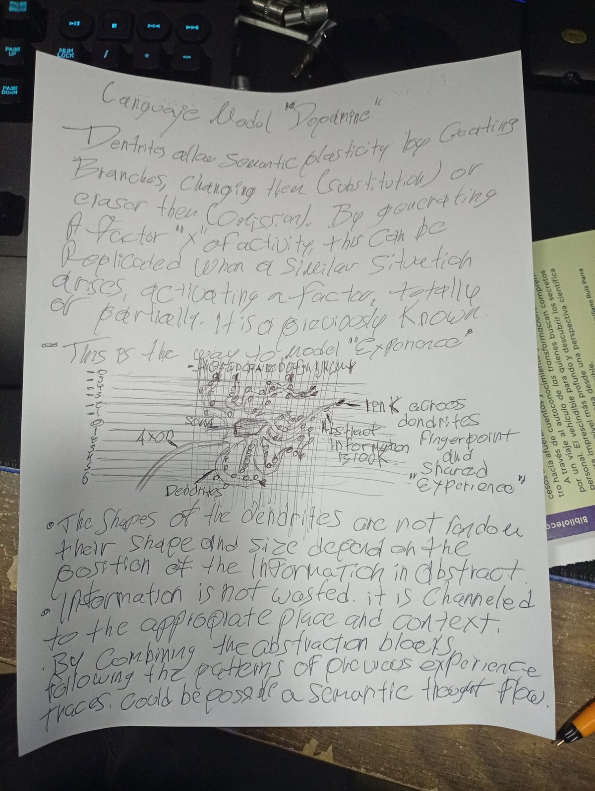

# BELEN

**Boost Enhance Limits to Expose Negations**

A small language model that is not a transformer stack with a new coat of paint. It is a neuron drawn on paper, turned into code, and opened so other people can break it, fix it and grow it.

TwoQuarks Research · Luis Jaime Ledesma Pérez · ORCID 0009-0008-8796-0800

---

## What each file does

**Entry point**

| File | What it does |
|---|---|
| `train_belen.py` | Trains the model. `--selftest` runs the CPU checks, `--params` prints the parameter budget. The evaluation tools also load this file to reach the model. |

**`belen/`: the model, one part per file**

| File | What it does |
|---|---|
| `config.py` | Every knob of the model, read from environment variables. `LEGACY=1` brings back the behavior from before the audit, switch by switch. |
| `layers.py` | The shared bricks: RMSNorm, linear layers, rotary positions, grouped attention and the MLP. |
| `dendrite.py` | Phase 1, experience. Three receptive fields (local, mid, global) read the same input in parallel, and each one has plastic prototypes that recall what it has seen before. |
| `geometry.py` | Optional shape for the dendrites. Each field gets its own L/R axes, a metric, a projection and a geodesic transport, so the shape of a dendrite depends on where the information sits. |
| `resonance.py` | Phase 1.75, emergent memory. A ring of past states of the Soma. It has no trainable parameters, it only keeps the trace of what already flowed. |
| `perception.py` | Phase 1.5, perception. Cross attention between what is happening now (the dendrites) and what already happened (the memory). Its output only exists when both meet. |
| `soma.py` | Phase 2, the medium. Attention and MLP blocks with a highway back to the embedding. It holds the flow without deciding it. |
| `axon.py` | Phase 3, selective transmission. Reads the last Soma layers as views and measures, token by token, how polarized they are. |
| `quarks.py` | The six polarization metrics (Down, Strange, Up, Charm, Top, Bottom) that summarize those views. |
| `cholinergic_gate.py` | Alternative Phase 3. A per token gate driven by how incoherent the trajectory is across layers, standardized online and without dead edges. |
| `molecule_gate.py` | A low rank correction of the logits, weighted by the stress signal that Phase 3 sends. Think before speaking. |
| `pfv_monitor.py` | Polarization from Views as an internal observer: polarization, its velocity and its acceleration over a set of realizations. It also gives the loss for test time training. |
| `ttt_iso.py` | Score first test time training. After a chunk is graded, only the perception agent adapts, guided by isomeric coherence, never by the targets. |
| `model.py` | Assembles the phases into BELEN and decides which Phase 3 and which dendrite are active. |
| `optim.py` | Muon for matrices, Lion for embeddings, AdamW for scalars and geometry, and the learning rate schedule. |
| `data.py` | Reads token shards, builds the validation set and the byte tables used to report bits per byte. |
| `train.py` | The training loop: logging, checkpoints, resume, and an ablation report at the end. |
| `evaluate.py` | Validation in bits per byte, with the memory isolated so that measuring does not change what is measured. |
| `checkpoint.py` | Saves raw weights with their hyperparameters and run metadata. |
| `compress.py` | Measures the compressed size of the model (int8 and low rank SVD) and distills the final memory. |
| `selftest.py` | CPU checks of shapes, causality, determinism, gradients, optimizer coverage and checkpoints. |
| `__main__.py` | Lets you run the package with `python -m belen`. |

**`docs/origin.jpg`**: the sheet of paper where it started.

**`requirements.txt`**: the Python packages the model needs.

**Colab notebook**: lives in the `Colab` branch as `BELEN_Colab.ipynb` ([open it in Colab](https://colab.research.google.com/github/Jaime2pb3/BELEN/blob/Colab/BELEN_Colab.ipynb)). It pulls the code from this repository, never from Drive.

**`eval_pii/`**: a measuring bench for partial PII leaks, wired to the model. It has its own [README](eval_pii/README.md).

**`tools/`**

| File | What it does |
|---|---|
| `ab_runs.py` | Paired runs that change one factor at a time with the same seed, data and schedule. |
| `calibrate_geometry.py` | Calibrates the L/R axes of the geometric dendrite from real neutral, left and right samples. |

**`tests/`**

| File | What it does |
|---|---|
| `test_regression.py` | With the new parts switched off, BELEN must match the audited reference: same parameters, same layout, same training losses. |
| `test_ach_and_geometry.py` | All six combinations of Phase 3 and geometry: they train, they get gradients, they save and load, and evaluation stays causal and deterministic. |

---

## Where it comes from

It started as a sheet of paper in March 2026, a neuron drawn by hand with a few lines written under it.

<p align="center"></p>
 That sheet said that dendrites allow semantic plasticity by creating branches, swapping them or erasing them. That a factor of activity could be replicated when a similar situation comes back, fully or partially, because it is something already known. That the shape of the dendrites is not random, it depends on where the information sits in the abstract. And that information is not wasted, it is channeled to the right place and context.

BELEN is that sheet, taken as literally as code allows.

- **The prototypes in the dendrites** are the branches. When the input looks like something seen before, the field recalls it.
- **The memory** is the trace of experience. It is not a warehouse, it is a record of the flow. Memory shows up when the present resembles the past.
- **The geometry** is the shape of the dendrite following the position of the information.
- **The Soma** is the medium, the vehicle and not the driver.
- **The axon** decides what gets transmitted, and the molecule gate is the pause before speaking.

The name of the first version was Dopamine. It was built in three days for the OpenAI Parameter Golf Challenge (a 16 MB artifact) and reached a validation bpb around 1.232 on a single RTX 3060. Then came ACH, the cholinergic version with the geometric dendrite. Its 22M run of 6500 steps ended at a validation bpb of 1.5811, and the diagnosis showed the gates had collapsed. That collapse is the reason `cholinergic_gate.py` has no clamps on its learnable parameters. BELEN joins both lines in one model on top of the audited 104M version, so every part can be switched on and off and compared against the others.

### Two ideas that run through everything

**Isomers.** In a pharmacy you learn early that two molecules can share the same formula and still behave in completely different ways, one heals and its mirror does not. Isomeric polarization takes that to the inside of a model: several views of the same state that look alike, and the question of how far apart they really are. The axon, the quarks, the PfV monitor and the test time training all speak that language.

**What changes, what stays, what moves you.** It is the way I have broken down concepts since I was fourteen: in anything, look at what changes, what remains and what drives it. Here it is not decoration, it is structure. The dendrites and the memory hold what changes, the Soma and the highway to the embedding hold what stays, and the gates carry what moves the flow toward one output or another.

---

## How to run it

Requirements: Python 3.10 or newer, PyTorch 2.5 or newer, numpy and sentencepiece (`pip install -r requirements.txt`). Training needs a GPU. The checks run on CPU.

```bash
python train_belen.py --selftest
python train_belen.py --params
python tests/test_regression.py
python tests/test_ach_and_geometry.py
```

Training reads token shards in the Parameter Golf format (FineWeb, 1024 token BPE vocabulary). The fastest path is the notebook in the `Colab` branch: open it in Colab with an A100, pick an arm, and run the cells in order. It clones this repository, downloads and verifies the data, trains and evaluates in steps through `eval_pii/ladder.py`. To train directly:

```bash
DATA_PATH=/path/to/fineweb10B_sp1024 \
TOKENIZER_PATH=/path/to/fineweb_1024_bpe.model \
ITERATIONS=6500 RUN_ID=belen_base python train_belen.py
```

The default size is about 104M parameters: 14 Soma blocks of width 768, 12 heads, MLP ×4, vocabulary 1024.

### The main switches

| Variable | Values | What it changes |
|---|---|---|
| `AXON_MODE` | `views` (default), `ach`, `noise` | Which Phase 3 transmits. `noise` is the old axon and is not causal, keep it only for comparison. |
| `GEOMETRIC_DENDRITE` | `0` (default), `1` | Turns on the geometry of the dendrites, with its own optimizer (`GEO_LR`, `GEO_WD`). |
| `TTT_ENABLED` | `1` (default), `0` | Score first test time training during validation. |
| `LEGACY` | `0` (default), `1` | Brings back the behavior from before the audit. |
| `ACH_THETA` | default `0.0` | The threshold of the cholinergic gate, measured in standard deviations of its signal and not in raw units. |

Every other knob lives in `belen/config.py` with its default value.

### Comparing parts

```bash
python tools/ab_runs.py --arms base geometry ach ach_geometry --seeds 42 43 44
```

One factor per arm, the same seed, data and schedule. Each run ends with an ablation report: complete model, frozen memory, memory collapsed to one averaged slot, memory set to zero, and no axon or gate.

---

## What is known and what is not

Verified on CPU:

- With geometry off and Phase 3 in `views`, BELEN matches the audited version in parameters, layout and training losses.
- All six combinations of Phase 3 and geometry train, receive gradients in their new parts, save and load exactly.
- In `views` and `ach` mode, evaluation is causal and deterministic.

Known caveats:

- **The geometry is not causal until its centers are initialized.** That happens on the first training step. A freshly built model with geometry on is not causal.
- **The cholinergic gate standardizes its signal with batch statistics during training**, the same way BatchNorm does. In evaluation it uses running statistics and is causal.
- **There are no performance numbers for BELEN yet.** Everything above checks that the machine works. Whether it learns better than a plain transformer of the same size is the question the first A100 runs have to answer.

---

## How we work here

A result is only a result once it survives a check that could have failed. Everything else is a claim, a hypothesis, noise or perception.

Building a model is like learning to cook from someone who does not write recipes down. You can follow every step and still not know which one made the dish work, unless you change one thing at a time and taste after each change. So:

- **One change per pull request**, with a switch that turns it off.
- **A baseline with the same seed** next to every result.
- **A planted check**: a case where you know the right answer before you measure. If your test passes a build we know is broken, a pass on the real one says nothing.
- **Every result gets posted**, whichever way it points. A result that goes against the hypothesis is not a failure, it is the information that tells us where to go next.
- **Tests stay green.** `test_regression.py` protects the audited base. If a change has to move it on purpose, say so and update the reference in the same pull request.

Log messages and CLI help are still in Spanish. Translating them is a good first contribution.

---

## License

Apache License 2.0. You can use it, change it and build on it, including commercially. 
In return, keep the `LICENSE` and `NOTICE` files with any copy, mark the files you changed, and state where the work comes from. 
The license also grants the patent rights the contributors hold over their contributions.

If BELEN helps your work, cite it as:

Luis Jaime Ledesma Pérez. BELEN. 
TwoQuarks Research, 2026. https://github.com/Jaime2pb3/BELEN
